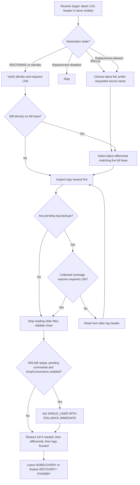

# Backup architecture

[Subsystem](readme.md) | [Object index](reference/readme.md)

## Installation and dependencies

The subsystem installs in System's alphabetical child order. Shared System modules precede feature children; System post scripts follow them. See [System documentation](../../docs/readme.md).

Uses server catalogs, msdb backup history, filesystem operations and native backup/create-database commands. Filesystem destinations need SQL Server service-account access; URL destinations need configured SQL Server credentials and storage permissions. Windows supports local folders and UNC shares; Linux uses local or mounted filesystem paths.

## Backup flow

`z.usp_BackupDatabase` resolves a database list and processes it once, sequentially by data-file size. For each database it creates a directory for filesystem destinations only, then performs native BACKUP TO DISK or BACKUP TO URL. A native backup error stops the call; previous files remain. New calls start fresh. Parallel jobs, shared assignments and persistent backup status are unsupported.

The backup procedure has no application lock. The cleanup helper locks only while cleaning up; it does not coordinate with active backups. Schedule standalone cleanup separately from backups.

Stop existing backup workers before upgrading. System post cleanup removes the retired status view and trigger. Old backup extended properties are no longer used or maintained; their presence does not affect execution.

## Destinations, retention and reporting

Azure HTTPS and S3 URLs use forward slashes on either operating system and retain their case. URL destinations skip filesystem operations. ServerName defaults to @@servername and only controls the naming prefix. Storage credentials and containers/buckets must already exist. S3 requires SQL Server 2022 or later.

Retention is never called by the backup procedure. `z.usp_CleanupDatabaseBackups` inventories files in the selected database's FULL, DIFF and LOG folders. Filename mode uses recognized six-digit timestamp names without opening headers; optional header mode supports irregular filenames and metadata dependency checks. Unrecognized names are preserved in filename mode. Neither mode guarantees complete recovery coverage. See [cleanup reference](reference/z.usp_CleanupDatabaseBackups.md).

`z.v_BackupRestore` reads msdb reporting history independently; that history does not choose deletion candidates. `z.usp_CreateDatabaseSnapshot` is separate from retention. The parameterless Full/Log wrappers use a fixed UNC destination; inspect them before use.

## Restore flow

`z.usp_RestoreDatabase` inventories one backup file, one HTTP(S)/S3 backup-object
URL, or a recursive filesystem folder. A URL always takes the single-file path;
remote directory discovery is unavailable. Native metadata and media restore
commands use FROM URL, preserving the supplied URL on either operating system.
Shared header/file-list readers return JSON, which the typed decoder
functions project without nesting INSERT EXEC. Exact producer filenames enable
newest-first discovery with fewer header reads; arbitrary names use broader
header inspection. A requested database name prefers a matching source, otherwise
the latest full supplies the source for a renamed restore. An omitted target is
inferred from the newest LOG header first, then its native state decides
continuation versus initialization/replacement. A FULL is searched only when
needed or when no LOG can identify the target. An inferred source family is
preserved across planning; an unrelated FULL cannot initialize that target.
Mixed-source folders
are supported. Headers bind the selected full, optional differential and logs to
one database family and recovery fork. File-list metadata drives explicit
physical-file MOVE mappings and destination collision checks.

For recognized filenames, continuation reads the current native redo position
first and identifies its source from LOG or DIFF headers without opening FULL
headers. Logs are scanned newest first until cached LSN ranges bridge back to
the target's required LSN, then restored forward. Newer full backups do not reset
a delayed target's log chain. Cached coverage is checked before another header
read; full-only continuation can remain a no-op without backup header reads.

File metadata is accumulated in restore order. Each mapping carries its introducing
ordinal, so full, differential and log commands receive only the MOVE clauses
needed at that step. Existing continuation files retain their paths; new files
use the same explicit/default/original folder policy, even for unchanged database
names. New-file names use the introducing backup's source name. File identity and
all planned paths are validated before executing any restore.

Planning first assembles media steps, then populates one final temporary execution
plan with all connection, restore, finalization and guarded cleanup SQL. Preview
selects that same table; execution consumes its rows in order. Media ordinals
remain stable for added-file MOVE mappings. Runtime state records whether access
was changed and the last proven destination identity; cleanup SQL is planned in
advance and reused on errors. The shared z.usp_PrintString and its splitting
functions must precede Backup deployment and provide long-command output.

OtherRestoreOptions defaults to STATS = 10 for media restores. Supplied text is
appended unchanged; SQL Server decides option validity during execution.
The engine may accept duplicates; this procedure does not normalize them. Generated headers, MOVE clauses and other options are separated into
readable lines; whitespace within supplied options is preserved.

The filename fast path requires one decoded database-name hint and assumes the
producer's timestamp/type convention. Multiple database-name hints use header
discovery so source renames cannot hide compatible logs. Server/instance prefix
variations and recognized legacy/new layouts for one database keep the fast path. Headers
confirm opened candidates, and LSN coverage includes any overlapping boundary log.
Differentials reduce the amount of log replay; reading fewer headers reduces
planning I/O. Neither optimization replaces validation of the selected chain.

An existing restoring or standby database is a continuation candidate; native
family/fork and current file redo metadata establish its identity and progress.
Existing file mappings come directly from sys.master_files. Retained history is
consulted only for unproven differential eligibility, unavailable standby redo
metadata. Already-covered DIFF candidates do not trigger that lookup.
Unavailable family/fork metadata selects full replacement when ReplaceExisting = 1;
otherwise it fails. OFFLINE and failed-start states also use replacement.
A known incompatible continuation still fails.
Other existing destinations require ReplaceExisting = 1. The selected commands
execute sequentially outside a user transaction. Failure leaves any completed
restore steps in place. DropConnections defaults to 1; an existing ONLINE target
with pending commands enters SINGLE_USER WITH ROLLBACK IMMEDIATE. Unavailable
targets and no-op restores skip setup. Preview reports setup/conditional cleanup
without executing either. Success/error cleanup restores the original access
mode only while the same destination is ONLINE; NORECOVERY cannot perform that
cleanup and no original access mode is persisted across calls. No individual
KILL commands, tail-log backup, folder creation or rollback of previously restored
databases is performed.

All intermediate commands leave NORECOVERY; the final state is NORECOVERY,
RECOVERY or STANDBY. SQL Server consumes the previous standby undo file internally;
the final STANDBY command writes the standardized target-name .standby file
under StandbyFolder or the primary data directory. Preview performs metadata
inspection and returns commands/mappings without restore execution. See the
[restore contract](reference/z.usp_RestoreDatabase.md).
