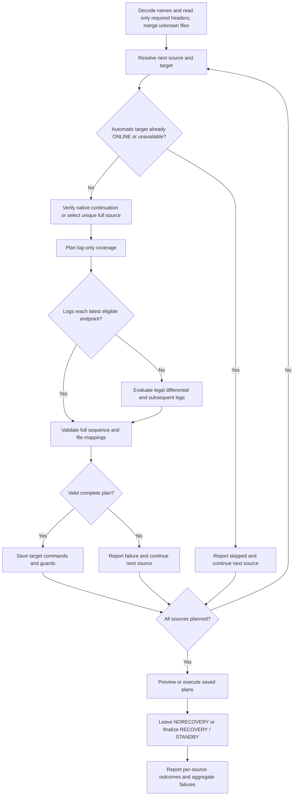

# Backup architecture

[Subsystem](readme.md) | [Object index](reference/readme.md)

## Installation and dependencies

The subsystem installs in System's alphabetical child order. Shared System modules precede feature children; System post scripts follow them. See [System documentation](../../docs/readme.md).

Uses server catalogs, msdb backup history, filesystem operations and native backup/create-database commands. Filesystem destinations need SQL Server service-account access; URL destinations need configured SQL Server credentials and storage permissions. Windows supports local folders and UNC shares; Linux uses local or mounted filesystem paths.

## Backup flow

`z.usp_BackupDatabase` resolves a database list and processes it once, sequentially by data-file size. For each database it creates a directory for filesystem destinations only, then performs native BACKUP TO DISK or BACKUP TO URL. A native backup error stops the call; previous files remain. New calls start fresh. For bounded parallel work, `z.usp_BackupDatabasesParallel` composes a separate
TaskQueue batch and launches Agent workers through Jobs. The sequential procedure
has no shared assignments or persistent execution status of its own.

The backup procedure has no application lock. The cleanup helper locks only while cleaning up; it does not coordinate with active backups. Schedule standalone cleanup separately from backups.

Stop existing backup workers before upgrading. System post cleanup removes the retired status view and trigger. Old backup extended properties are no longer used or maintained; their presence does not affect execution.

## Destinations, retention and reporting

Azure HTTPS and S3 URLs use forward slashes on either operating system and retain their case. URL destinations skip filesystem operations. ServerName defaults to @@servername and only controls the naming prefix. Storage credentials and containers/buckets must already exist. S3 requires SQL Server 2022 or later.

Retention is never called by the backup procedure. `z.usp_CleanupDatabaseBackups` inventories files in the selected database's FULL, DIFF and LOG folders. Filename mode uses recognized six-digit timestamp names without opening headers; optional header mode supports irregular filenames and metadata dependency checks. Unrecognized names are preserved in filename mode. Neither mode guarantees complete recovery coverage. See [cleanup reference](reference/z.usp_CleanupDatabaseBackups.md).

`z.v_BackupRestore` reads msdb reporting history independently; that history does not choose deletion candidates. `z.usp_CreateDatabaseSnapshot` is separate from retention. The parameterless Full/Log wrappers use a fixed UNC destination; inspect them before use.

## Restore flow

`z.usp_RestoreDatabase` inventories one backup file, one HTTP(S)/S3 backup-object
URL, or a recursive filesystem folder. A URL always takes the single-file path;
remote directory discovery is unavailable. Native metadata and media restore
commands use FROM URL, preserving the supplied URL on either operating system.
Shared header/file-list readers return JSON, which the typed decoder
functions project without nesting INSERT EXEC. Filename decoding groups recognized
files by source labels and orders them newest first. Trust those names for source
grouping and chronology; cache every appended set from each inspected file and
walk backward only until a complete chain is proven. Inspect nonconforming names
afterward, merge their sets, then revisit recognized groups when an older base or
chain segment is still required. Unopened containers are outside source discovery;
newly appended sets must preserve the convention's grouping and ordering.

An explicit missing destination requires exactly one usable full-backed source
family. Several full backups of one family count once; foreign standalone logs
and differentials cannot initialize another database and do not increase the
count. Existing RESTORING/STANDBY targets select by native family/fork and redo
position, including renamed destinations. Newer full backups do not restart a
continuation target. LSN comparisons never merge unrelated families or branches.
For initialization/replacement, the newest full by completion time establishes
the supported branch. Evaluate full starts and matching differentials on that
branch to reach the latest endpoint; a newer copy-only full must not hide a later
differential based on an older regular full. Prefer a route without a differential
when endpoints tie.

With no target, each user source is processed independently under its source
name. Missing targets are initialized when a usable full is available; otherwise
the source is deferred. Existing ONLINE/unavailable targets are skipped even when
ReplaceExisting = 1. System sources are excluded, and the hosting database,
snapshots and AG targets remain protected. Source-name collisions across families
are reported rather than overwritten.
After a source rename, reuse a unique matching continuation target among known
source-name aliases. If the family already has a continuation target whose name
cannot be resolved from the retained headers, require an explicit target instead
of initializing a duplicate.

The implementation helper `z.usp_RestoreDatabaseTarget` consumes the caller's
inventory and saves each destination's commands, file mappings and state in shared
temporary tables. Every target finishes planning before execution begins.
`z.usp_RestoreDatabaseExecute` then consumes the saved commands with destination
and cleanup guards. Call `z.usp_RestoreDatabase` as the supported entry point.
The per-target planner first computes log-only coverage. It prefers logs when
they reach the latest eligible endpoint, otherwise considers a differential that
matches the full base and can legally extend the endpoint. A differential cannot
follow intervening log restores. The complete chain is checked before execution;
an unbridgeable gap fails that target without applying a prefix or silently
reseeding. Other independent targets continue and retain individual outcomes.
File-list metadata drives explicit physical-file MOVE mappings and collision
checks, preserving every input path even when media belongs to another source.
Validated destination and standby paths are also reserved across targets for the
current call, including preview. A later target cannot plan the same output path.
Reservations last until the call returns, including after an execution failure;
they are temporary planning checks and do not lock filesystem paths.

File metadata is accumulated in restore order. Each mapping carries its introducing
ordinal, so full, differential and log commands receive only the MOVE clauses
needed at that step. Existing continuation files retain their paths; new files
use the same explicit/default/original folder policy, even for unchanged database
names. New-file names use the introducing backup's source name. File identity and
all planned paths are validated before executing any restore.

Planning first assembles media steps, then populates one final temporary execution
plan with all connection, restore, finalization and guarded cleanup SQL. Preview
selects that same table; execution consumes its rows in order. Media ordinals
remain stable for added-file MOVE mappings. Runtime state records whether access
was changed and the last proven destination identity; cleanup SQL is planned in
advance and reused on errors. The shared z.usp_PrintString and its splitting
functions must precede Backup deployment and provide long-command output.

OtherRestoreOptions defaults to STATS = 10 for media restores. Supplied text is
appended unchanged; SQL Server decides option validity during execution.
The engine may accept duplicates; this procedure does not normalize them. Generated headers, MOVE clauses and other options are separated into
readable lines; whitespace within supplied options is preserved.

Log coverage includes any backup overlapping the required starting LSN. Filename
timestamps and extensions do not prove identity or chain coverage. Appended backup
sets use FILE = position; assembling striped backups remains unsupported.

An existing restoring or standby database is a continuation candidate; native
family/fork and current file redo metadata establish its identity and progress.
Existing file mappings come directly from sys.master_files. Retained history is
consulted only for unproven differential eligibility, unavailable standby redo
metadata. Already-covered DIFF candidates do not trigger that lookup.
Automatic mode does not replace existing targets when identity is unavailable.
Explicit requests retain the guarded replacement path for unavailable identity,
OFFLINE and failed-start states when ReplaceExisting = 1. A known incompatible
continuation still fails. Other explicit existing destinations also require
ReplaceExisting = 1 and an unambiguous full-backed source. The selected commands
execute sequentially outside a user transaction. Failure leaves any completed
restore steps in place. DropConnections defaults to 1; an existing ONLINE target
with pending commands enters SINGLE_USER WITH ROLLBACK IMMEDIATE. Unavailable
targets and no-op restores skip setup. Preview reports setup/conditional cleanup
without executing either. Success/error cleanup restores the original access
mode only while the same destination is ONLINE; NORECOVERY cannot perform that
cleanup and no original access mode is persisted across calls. No individual
KILL commands, tail-log backup, folder creation or rollback of previously restored
databases is performed.

All intermediate commands leave NORECOVERY; the final state is NORECOVERY,
RECOVERY or STANDBY. SQL Server consumes the previous standby undo file internally;
the final STANDBY command writes the standardized target-name .standby file
under StandbyFolder or the primary data directory. Preview performs metadata
inspection and returns commands/mappings without restore execution. See the
[restore contract](reference/z.usp_RestoreDatabase.md).
