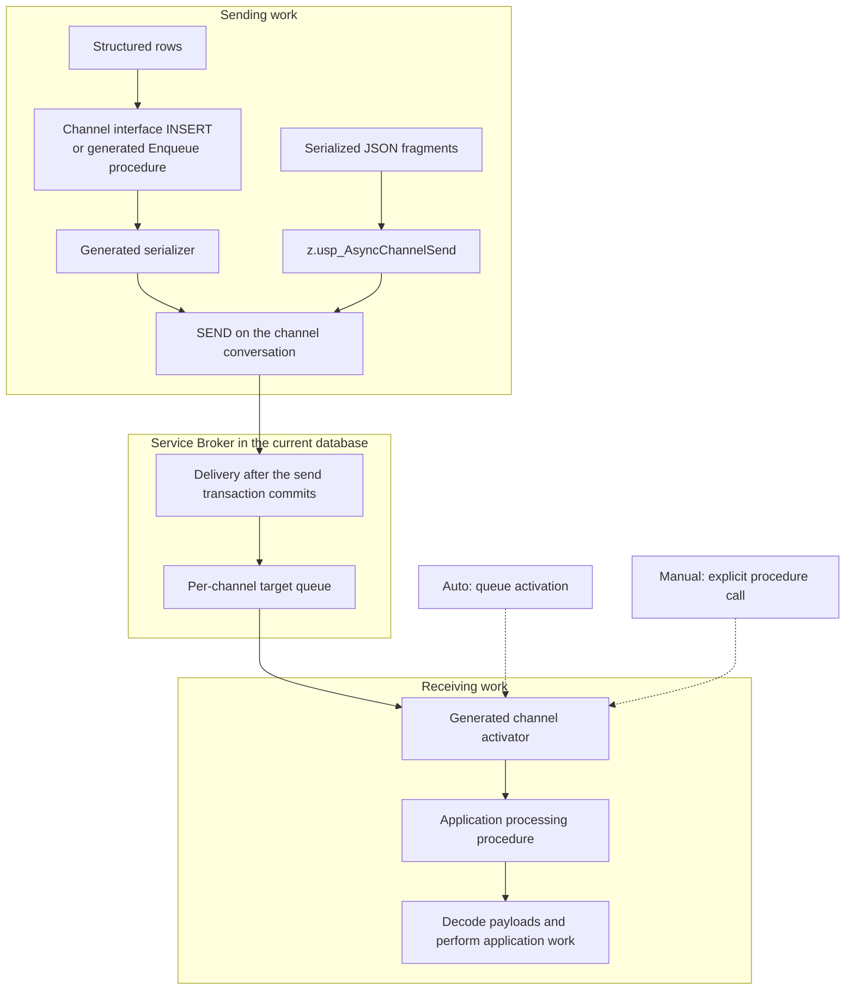
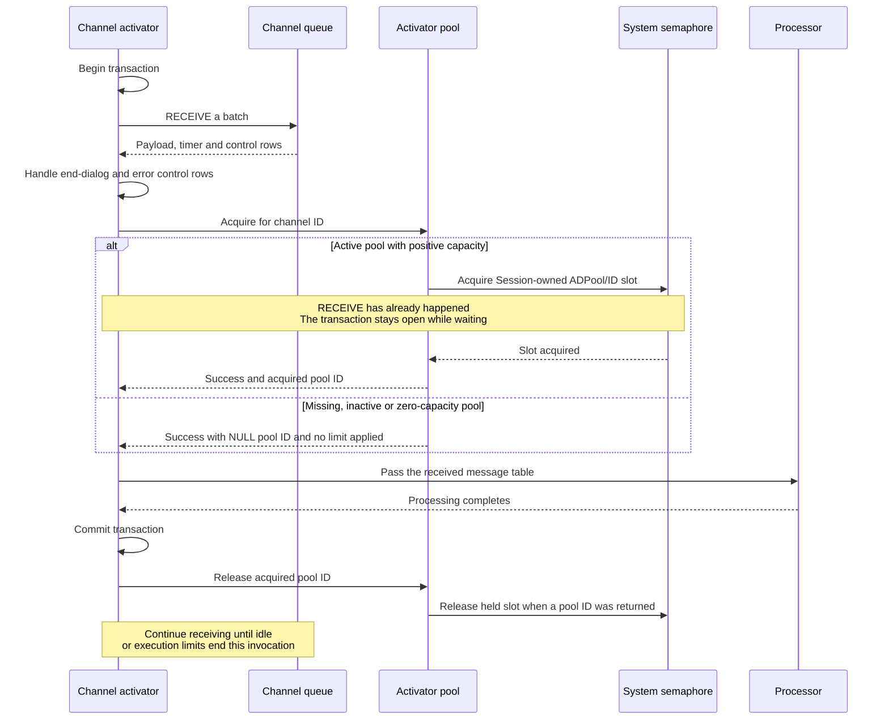
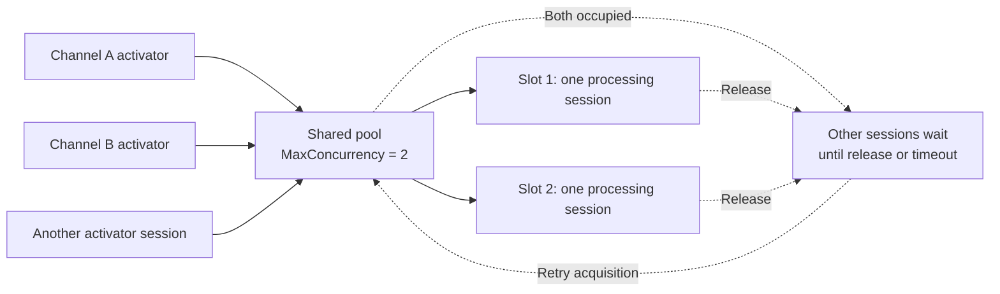
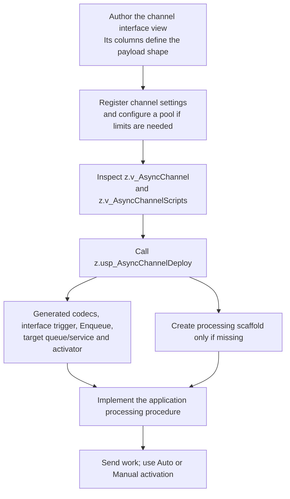

# Architecture and limitations

[AsyncChannel](readme.md)

## Message flow

An application sends work to a channel conversation. Service Broker delivers it to the channel's queue, and a generated activator calls the application processing procedure. Sending and processing can run in different sessions and transactions; the caller does not wait for processing to finish.

The channel interface trigger and generated Enqueue procedure serialize typed inputs and send on a conversation obtained through `z.usp_AsyncChannelGetConversationHandle`. Already serialized fragments can use `z.usp_AsyncChannelSend`; the shared messaging interfaces and forwarding helper also use that send helper. The processing procedure receives a `z.AsyncChannelMessage` table, checks `IsPayload`, and can call the generated deserializer for payload rows. Timer and control rows are not JSON application payloads.

For a batch containing payload or timer messages, the activator follows this sequence. Auto and Manual activation use the same generated procedure. The diagram shows a successful processing transaction; rollback and retry behavior is described below.

If pool acquisition returns failure, the activator rolls back the received batch and exits without calling the processor. A processing error follows the rollback/error path below. A slot is held through processing and the activator's commit; applications that supply an outer transaction must account for the caller-wide transaction behavior described below.

## Framework and message contract

`050-AsyncChannel` is an independent subsystem with its own deployment identity. It currently has no version migration. Its guarded baseline creates four tables, the message table type, a shared sender queue/service and the message/contract. Functions and views precede generators and lifecycle procedures. The sender activation binding follows its procedure; shared interface triggers follow their views and send procedures.

Interface views follow `<schema>.<Name>_Interface` without the ordinary view prefix `v_`; their triggers use `TRI_<Name>_Interface`. This applies to both shared messaging interfaces and generated channel interfaces. The opt-in demo creator is installed after the framework helpers and triggers. Installing its definition does not instantiate the example.

System supplies `z.SeqGeneralID`, `z.fn_GetFullErrorMessage()`, `z.usp_AcquireSemaphore`, `z.usp_ReleaseSemaphore` and `PS_SchemaZPartitionGeneric`. The log uses the shared bigint partition scheme and the UTC-seconds/28-bit-sequence identifier formula. No application-specific storage policy or pool/channel rows are installed.

Broker identities use `/SchemaZ/AsyncChannel/Message`, `/SchemaZ/AsyncChannel/Contract` and `/SchemaZ/AsyncChannel/Sender`. Per-channel target services include the processing schema and channel name. Payloads are Unicode JSON fragments; the message type has no Broker-level content validation. The contract permits application messages from the initiator. All dialogs target the current database with encryption off.

`z.AsyncChannelMessage` carries `ConversationHandle uniqueidentifier`, `MessageTypeID int`, `SequenceNumber bigint`, `IsPayload bit`, and nullable `Payload nvarchar(max)`. All other fields are required. Processing receives native message rows, including timer/control messages. Inspect `IsPayload` before decoding payloads. Ordering is per conversation; no global ordering across senders is promised.

## Shared processing capacity

Channels assigned to the same pool compete for one shared capacity limit. For example, `MaxConcurrency = 2` permits two sessions to hold processing slots across all channels in that pool. Each channel's `Readers` setting separately controls its maximum automatic queue readers; the pool limits admission to processing after a batch has been received.

Activator pools acquire a Session-owned shared semaphore named `ADPool/<ActivatorPoolID>`, with capacity from MaxConcurrency. A missing, inactive or zero-concurrency pool imposes no limit. A positive shared-helper result is the slot; zero or negative results are failures. The wrapper retains its return contract of 0 on success and -1 with cleared outputs on failure. TimeoutSeconds is converted to milliseconds, with -1 retaining an indefinite wait; finite waits are capped at 2147483647 milliseconds to avoid overflow. Repeated acquisition by the same session and owner returns the existing slot without increasing native lock counts; only the outer operation releases the permit. Do not synchronously invoke another generated activator sharing that pool from a processing procedure: its automatic release would free the outer permit. A custom nested path must leave release to the outer operation. The shared helper stores the slot in session context and retrieves it on release. Pool procedures and generated activators pass only the acquired pool ID; no slot output or expected-slot argument is needed. Slots are released after processing commits or fails. Existing generated activators using the earlier slot parameters require regeneration with `z.usp_AsyncChannelDeploy @ForceDeployment = 1`; authored interface and processing objects are preserved.

The pool view reads current-database Session-owned semaphore locks. It counts granted exclusive slot resources (`<slot>-ADPool/<ID>`) and infers SessionsWaiting from sessions with a granted main intent-exclusive marker (`ADPool/<ID>`) but no granted slot. These are advisory snapshots of a polling protocol, not exact queued-waiter counts; native WAIT rows alone do not describe pool demand. A canceled acquisition can leave a marker counted as waiting until its session disconnects. Pool timeouts, cancellation and concurrent lifecycle operations need validation for the intended workload.

## Logging

Logging uses session context to preserve non-Debug rows while a transaction is open, then flushes outside a transaction. The buffer retains at most 40 rows and truncates buffered Info/Payload values to 4,000 characters. Excess rows are counted and reported on flush. Session closure before flushing loses buffered rows. Debug rows are written in the current transaction and roll back with it. Direct inserts and flush errors can propagate; buffering errors are suppressed. No linked server is required.

## Channel generation and application ownership

The framework installation supplies shared infrastructure and generators. Creating a usable application channel is a separate step:

The application owns the authored interface, processing logic and any destination tables. The generator preserves existing interface and processing objects, including during forced generation. It creates a placeholder processing procedure if missing. Author the interface before generation: scripts are materialized in a static cursor, so creating a missing placeholder interface does not refresh dependent templates within that call. Automatic generation currently assumes conventional column names and supported built-in types; unusual identifiers, alias types and exact sql_variant precision are not guaranteed. The metadata view reports some signature and reserved-name errors; it is not a complete deployment validator.

## Failure handling and operational limits

Inactive sends are silently discarded. Unknown-channel sends log and return; forwarding logs and skips unknown target IDs. Activation rolls back a failed batch, attempts error logging, waits five seconds and returns. Poison-message handling is off, so failing work can be retried indefinitely. Callers should monitor logs and queues and handle permanently failing data. Transaction failure paths can roll back the caller's entire transaction. The conversation helper uses a binary Transaction-owned shared semaphore, waits indefinitely and rejects a nonpositive acquisition result. That semaphore remains held until the actual outer transaction commits or rolls back.

`MaxExecutionSeconds` and idle limits are cooperative loop checks, not hard limits on a callback or lock wait. Timer setup changes the endpoint's single pending timer and takes effect when the transaction commits. Removal uses forced conversation cleanup and discards outstanding work for the selected channel. It preserves authored interfaces and processing procedures. A complete framework uninstaller is not supplied here.
