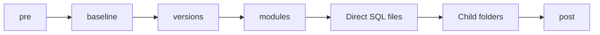

# How deployment works

## Responsibilities

| File | Responsibility |
| --- | --- |
| `Deploy.ps1` | Orchestrate bootstrap, deployment or optional test-only execution, logs, and completion |
| `Deploy.sql` | Create a missing database and initialize current deployment metadata |
| `Deploy.Common.ps1` | Build traversal plans and provide shared SQL/connection helpers |

The deployer validates the folder tree, runs bootstrap, opens a metadata
connection, and acquires an exclusive database-local lock. It then reads installed
versions and builds the actual execution plan before running product scripts.
The lock covers product deployment; bootstrap runs before that lock is acquired.

After bootstrap, deployment metadata is read and changed only through typed
stored-procedure calls. SQL Server procedures raise lock, namespace, and batch
validation errors; subsystem/batch creation and completion are transactional.
PowerShell handles folder planning and calls the procedures. Developer SQL files
execute directly as written; they are not rewritten by the metadata layer.

| Procedure | Metadata operation |
| --- | --- |
| `z.usp_AcquireDeploymentLock`, `z.usp_ReleaseDeploymentLock` | Hold and release the deployment session lock |
| `z.usp_GetDeploymentSystems` | Read completed subsystem versions |
| `z.usp_BeginDeployment` | Register a subsystem and start its batch |
| `z.usp_GetDeploymentHashes`, `z.usp_RemoveDeploymentHash` | Read hashes and prune unused eligible hashes |
| `z.usp_CreateDatabaseUpdateLog` | Register content before execution and record hash-linked execution logs |
| `z.usp_CompleteDeployment` | Validate the batch and atomically advance version/close batch |
| `z.usp_FailDeployment` | Mark an unsuccessful batch |

## Folder order

```text
System/
  pre/
  baseline/
  versions/
    0.0.1/
    0.0.2/
  modules/
  *.sql
  ChildSubsystem/
    ...same structure...
  post/
  tests/
  docs/
```



Every executed folder follows this order recursively. Optional stages may be
absent. Direct SQL files and ordinary child folders use case-insensitive ordinal
name sorting; numeric version folders use .NET version ordering.
`tests` is excluded from normal deployment; `-RunTests` executes only tests.
`docs` is excluded from both deployment and
test discovery. Linked folders are rejected.

Use `pre` for prerequisites/preparation, `baseline` for the initial foundational
objects, `versions` for versioned changes, `modules` for repeatable functions/views/
procedures, and `post` for work that requires completed children.

Baseline establishes the starting point for versions. Once its owning subsystem
has a completed version above `0.0.0`, skip the entire baseline subtree, including
its pre/post folders. This rule is independent of hash checking. A new child still
runs its own baseline even when the parent is already versioned. Subsystems at
`0.0.0`, including those without numbered versions, retain baseline eligibility.

Nonreserved child folders directly under a subsystem become child subsystems.
Folders below reserved stages are organizational only. For example:

| Folder | Version owner |
| --- | --- |
| `System/Accounting` | `/System/Accounting` |
| `System/Accounting/Reports` | `/System/Accounting/Reports` |
| `System/modules/Accounting` | `/System` |
| `System/Accounting/baseline/Tables` | `/System/Accounting` |
| `System/Accounting/docs` | No execution or version record |

A `versions` container can have its own reserved stages and direct SQL files.
Its other children must be numbered versions. Within each numbered folder,
the normal recursive execution order applies.

## Independent versions

`z.Systems` stores one completed version per subsystem using paths such as
`/System` and `/System/Accounting` in `CodeBase`, an `nvarchar(4000)` column.
`SystemID` is a stored `uniqueidentifier` derived from the MD5 hash of
`trim(lower(CodeBase))`. Case and surrounding spaces are ignored for identity.
Batch, hash, and log tables reference `SystemID` through foreign keys rather
than repeating the codebase string. SQL resolves installed versions for each
requested path, so the client does not duplicate SQL's normalization rules.

For each subsystem, the highest numbered folder in its own `versions` directory
is the target. A new subsystem starts at `0.0.0`. The installed version and newer
folders execute in numeric order: if installed at `0.0.2`, `0.0.2` runs again and
`0.0.10` runs afterward. Older folders are skipped.

An installed version above the available maximum is rejected before product
scripts execute. When no numbered folders exist, an existing version is retained.
A version is recorded as completed only after that subsystem's scripts, children,
and `post` succeed. A completed child keeps its version if its parent later fails.

## Hashes and execution history

Hash skipping is enabled by default; disable it with `-DisableHashChecking`.
Successful script content is identified by SHA-256 within
the owning subsystem. Identical content at different paths in that same subsystem
can therefore be skipped; matching content in another subsystem is independent.
Metadata stores `FileHash` as `varbinary(32)`, the raw 32-byte SHA-256 digest,
instead of a hexadecimal string. Normal deployment hashes every executed file,
including pre/post. Eligible `pre` and `post` and their descendants always execute
without comparing hashes. Stages inside a skipped baseline do not execute.

Register hashes before executing scripts; failed records are retained. Only
current successful hashes (`IsCurrent`/`HasSucceeded`) permit skipping. The hash
inventory includes all current records and their success status; the client
separates inventory from successful skip candidates. Identical
contents use the first registered filename as canonical.
On successful completion, unused hashes outside baseline/version folders are
marked inactive, preserving historical log references. Successful baseline and
version hashes remain active; removed/replaced failed records in those folders
retire while their rows remain. Moving or deleting
a script does not delete the SQL
objects it previously created.

| Metadata | Purpose |
| --- | --- |
| `z.Systems` | Last completed subsystem version and completion date |
| `z.SystemUpdateBatch` | Subsystem deployment attempt and success/failure status |
| `z.SystemUpdateBatchLog` | Script start/end and error, linked by SystemID/FileHash; no filename/content |
| `z.SystemScriptHash` | Content hashes, canonical filename/content, current/success status |

Bootstrap creates missing metadata tables using the current schema and refreshes
the deployment procedures. Repeating bootstrap preserves existing current-schema
records. It does not migrate older schemas or rename legacy subsystem records.

`-RunTests` discovers only reserved tests in recursive order. Batches use version
`Test`; subsystem versions/dates do not advance. No hashes are calculated,
compared, or stored for tests; unhashed log entries use batch/log IDs only.

## Script authoring and failure behavior

- Write scripts that tolerate repeated execution, including current-version migrations.
- Arrange filenames/folders so prerequisites precede their dependants.
- Each script runs in a separate SQL invocation; do not depend on connection-local
  temporary tables or session settings from a previous file.
- Standard session options and transaction-leak checks wrap every executed file.
  Close every transaction you open; a leftover transaction causes an error.
- There is no transaction covering the whole deployment. A later error does not
  undo earlier completed scripts; make retry behavior deliberate.
- Only `.sql` files execute. README files and other documentation are ignored.
- Use UTF-8 without BOM and CRLF line endings for SQL files.
- PowerShell masks content containing password/encryption keywords before sending
  it to metadata logging procedures. SQL does not sanitize incoming content.
  File hashes are calculated from original content before masking. Actual SQL
  execution still sends the original script to the server; metadata masking
  does not hide that execution from tracing. Keep credentials out of scripts.

After changing deployment scripts, verify initial deployment, redeployment,
version tracking, and error handling in a disposable test database.
